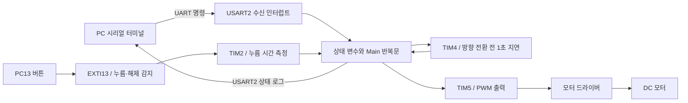

# STM32 기반 DC 모터 제어 시스템

> **UART 명령과 버튼 입력으로 DC 모터의 회전 방향·정지·PWM 듀티를 제어하는 Cortex-M4 임베디드 프로젝트**

STM32F411의 GPIO, USART, EXTI, 타이머와 NVIC를 레지스터 수준에서 제어합니다.
버튼을 누른 시간에 따라 동작을 구분하고, 회전 방향을 바꿀 때 약 1초의 정지 구간을 두는 것이 주요 설계입니다.

## 프로젝트 개요

### 프로젝트 소개

PC의 시리얼 터미널 또는 보드의 버튼으로 DC 모터 1개를 조작하는 시스템입니다.
UART 수신과 버튼 에지 감지는 인터럽트로 처리하고, 메인 반복문에서 상태 변화를 확인해 모터 출력을 적용합니다.

| 항목 | 내용 |
| --- | --- |
| **프로젝트명** | MINI_MOTOR_PROJECT — STM32 기반 DC 모터 제어 시스템 |
| **개발 언어** | C / ARM Assembly |
| **대상 MCU** | STM32F411xE, ARM Cortex-M4 |
| **구현 방식** | CMSIS 장치 헤더를 이용한 레지스터 직접 제어, Bare-metal |
| **입력** | UART 단일 문자 명령 / PC13 버튼 |
| **통신** | USART2, 115200 baud, 8N1 |
| **구동부** | DC 모터 1개 / 모터 드라이버 IC |
| **타이머** | TIM2: 버튼 누름 시간, TIM4: 방향 전환 지연, TIM5: PWM |
| **시스템 클록** | HCLK 96 MHz / PCLK1 48 MHz |
| **빌드·다운로드** | Arm GNU Toolchain / Make / STM32CubeProgrammer CLI |
| **설계 문서** | [MINI_PROJECT 상위 설계서](https://app.notion.com/p/MINI_PROJECT-3a61c0a0f86e8017872aecc8127ddfbf) |

이 README는 현재 GitHub 저장소의 TIM2·TIM4·TIM5 기반 구현을 설명합니다.
별도로 작성한 상태 머신 개선 버전의 구조와 테스트 결과는 현재 저장소의 구현·검증 결과에 포함하지 않습니다.

---

## 주요 기능

- **회전 방향 제어:** UART 또는 버튼으로 CW / CCW 회전 요청
- **모터 정지:** UART 정지 명령 또는 버튼 길게 누름으로 정지 요청
- **PWM 듀티 조절:** 숫자 명령으로 50~90% 범위를 5%p 간격으로 설정
- **버튼 입력 구분:** 누름 시간을 측정해 짧게 누름 / 길게 누름 구분
- **방향 전환 지연:** 회전 중 반대 방향을 요청하면 약 1초 정지 후 반전
- **인터럽트 기반 입력 처리:** USART2, EXTI13, TIM2, TIM4 활용
- **상태 로그 출력:** UART로 시작·회전 방향·정지·버튼 상태 메시지 출력

PWM 듀티를 조절하는 개방 루프 제어이며, 실제 RPM 측정이나 PID 속도 제어는 구현하지 않습니다.

---

## 시스템 요구사항

### 하드웨어 구성

노션 상위 설계서의 주변장치 구성을 기준으로 합니다.

| 구성품 | 수량 | 용도 |
| --- | --- | --- |
| STM32F411 기반 보드 | 1개 | 입력 처리 및 모터 제어 |
| DC 모터 | 1개 | 정·역방향 회전 구동 |
| 모터 드라이버 IC 또는 모듈 | 1개 | MCU 제어 신호를 받아 모터 구동 |
| USB-UART TTL 시리얼 모듈 | 1개 | PC와 USART2 통신 |
| 버튼 | 1개 | PC13 입력, 보드 내장 버튼 사용 가능 |
| SWD 디버거 및 적절한 전원 | 필요 | 펌웨어 다운로드와 보드·모터 전원 공급 |

보드와 모터 드라이버의 정확한 모델명은 확인한 텍스트 자료에 명시되어 있지 않습니다.
회로도와 상태 전이 원본 이미지는 [상위 설계서](https://app.notion.com/p/MINI_PROJECT-3a61c0a0f86e8017872aecc8127ddfbf)에서 확인할 수 있습니다.

### 개발 환경

- Arm GNU Toolchain: Makefile 기본 경로 기준 15.2.Rel1 / GCC 15.2.1
- Make 실행 환경, `make clean`을 사용할 경우 `rm` 명령
- STM32CubeProgrammer CLI
- UART 시리얼 터미널

---

## 기능 요구사항

### 모터 제어

- 시스템 초기 상태를 모터 정지로 설정한다.
- CW 또는 CCW 명령에 따라 해당 방향으로 구동한다.
- 현재 회전 방향과 반대 방향을 요청하면 출력을 정지하고 약 1초 후 반전한다.
- 정지 요청 시 모터 제어 출력을 LOW로 설정한다.
- 숫자 입력에 따라 PWM 듀티 단계를 변경한다.

### 버튼 제어

- 정지 중 짧게 누르면 CW 구동을 시작한다.
- 회전 중 짧게 누르면 약 1초 정지 후 반대 방향으로 구동한다.
- 길게 누르면 정지를 요청한다.
- 짧게·길게 누름 사이의 중간 시간 입력은 제어 동작 없이 대기로 복귀한다.

### 통신 및 상태 출력

- UART로 `F/f`, `R/r`, `S/s`, `0`~`9` 단일 문자 명령을 수신한다.
- `printf`를 USART2 송신으로 연결해 동작 상태와 디버그 메시지를 출력한다.

위 항목은 설계된 동작입니다. 방향 전환 중 정지와 반복 버튼 입력에는
[현재 구현의 제한사항](#현재-구현의-제한사항)이 있으므로 모든 입력 조합에서 보장되는 동작과는 구분해야 합니다.

---

## 시스템 구성

아래 구성도는 소스코드의 역할을 요약한 것이며, 실제 전원·드라이버 배선도는 아닙니다.



### 핀 및 주변장치

| 핀 / 주변장치 | 설정·용도 |
| --- | --- |
| PA0 / TIM5_CH1, AF2 | CCW 시 PWM, CW·정지 시 LOW |
| PA1 / TIM5_CH2, AF2 | CW 시 PWM, CCW·정지 시 LOW |
| PA2 / USART2_TX, AF7 | 상태·디버그 로그 송신 |
| PA3 / USART2_RX, AF7 | 명령 수신 |
| PC13 / EXTI13 | Active LOW 버튼, Falling / Rising Edge 감지 |
| PA5 | LED 초기화, 현재 제어 루프에서는 상태 표시로 사용하지 않음 |
| PA13 / PA14 | 시작 코드에서 디버그용 핀 설정 잠금 |
| TIM2 | 버튼 누름 시간 측정, 최대 약 3초 |
| TIM4 | 방향 전환 전 약 1초 정지 구간 |
| TIM5 | PWM 출력, 코드상 요청 주파수 10 kHz |

PA0·PA1은 모터 드라이버의 논리 입력에 연결합니다.
실제 CW/CCW 방향과 두 입력이 LOW일 때의 브레이크·코스트 동작은 드라이버 및 배선에 따라 달라집니다.
MCU 핀에 모터를 직접 연결하지 않으며, 전원·논리 전압·공통 GND는 사용하는 보드와 드라이버에 맞게 구성합니다.

---

## 제어 방법

### UART 명령

시리얼 터미널을 **115200 baud / 8 data bits / no parity / 1 stop bit / flow control 없음**으로 설정합니다.
명령은 한 문자 단위이므로 줄바꿈 없이 전송합니다.

| 명령 | 설계된 동작 |
| --- | --- |
| `F` / `f` | CW 회전 요청 |
| `R` / `r` | CCW 회전 요청 |
| `S` / `s` | 정지 요청 |
| `0` | 정지 요청 |
| `1`~`9` | PWM 듀티 단계 변경 |

반대 방향 구동 중 `F` 또는 `R`을 받으면 `Key_Short` 처리 경로에 연결해
TIM4로 약 1초 대기 후 방향을 바꿉니다.

| 숫자 명령 | 계산상 듀티 |
| --- | --- |
| 1 | 50% |
| 2 | 55% |
| 3 | 60% |
| 4 | 65% |
| 5 | 70% |
| 6 | 75% |
| 7 | 80% |
| 8 | 85% |
| 9 | 90% |

- 기본 단계는 `1`이며, 계산식은 `45 + 5 × duty`(%)입니다.
- `duty`는 실제 퍼센트 값이 아니라 **1~9 단계값**입니다.
- `0`은 듀티 0% 설정이 아니라 정지 명령입니다.
- 정지 상태에서 숫자를 입력하면 다음 구동에 사용할 단계가 저장됩니다.
- 위 듀티는 코드 계산 기준이며 실제 PWM 파형은 계측으로 확인해야 합니다.

**사용 예시**

```text
F 전송 → CW 구동
5 전송 → 듀티 70% 설정
R 전송 → 약 1초 정지 후 CCW 구동
방향 전환 완료 후 S 전송 → 정지 요청
```

상태 로그에는 `start`, `cw`, `ccw`, `Motor Stop`, `Key_Short` 등이 출력됩니다.

### 버튼 입력

| 누름 시간 | 판정 | 설계된 동작 |
| --- | --- | --- |
| 약 900ms 이하 후 해제 | Short Key | 정지 중 CW 시작 / 회전 중 1초 대기 후 반전 |
| 약 900ms 초과~2100ms 미만 후 해제 | 중간 입력 | 동작 없이 대기로 복귀 |
| 약 2100ms 이상 후 해제 | Long Key | 정지 요청 |
| 약 3000ms 계속 누름 | TIM2 만료 | 버튼 해제 전 정지 요청 |

설계서의 Long Key 표에는 ‘2100ms 이하’로 적혀 있지만,
실제 코드 조건은 `btn_holding_time >= LONG_KEY_TIME`입니다.
이 문서는 **2100ms 이상**을 기준으로 설명합니다.

---

## 상태 및 인터럽트 설계

### 모터·버튼 상태

| 구분 | 상태 | 의미 |
| --- | --- | --- |
| 모터 | `MOTOR_STOP = -1` | 정지 |
| 모터 | `MOTOR_CW = 0` | CW 회전 |
| 모터 | `MOTOR_CCW = 1` | CCW 회전 |
| 버튼 | `Key_Wait` | 입력 대기 |
| 버튼 | `Key_Hold` | 누름 시간 측정 |
| 버튼 | `Key_Short` | 짧게 누름 또는 UART 방향 전환 요청 |
| 버튼 | `Key_Long` | 길게 누름 |
| 버튼 | `Key_Pause` | 버튼 해제 또는 방향 전환 완료 대기 |

현재 구현은 별도 모터 반전 상태 대신 `Key_Pause`, `TIM4_Expired`,
현재 모터 상태를 조합해 대기를 처리합니다.

### 주요 변수

| 변수 | 역할 |
| --- | --- |
| `cur_motor_state` | 현재 모터 상태 |
| `pre_motor_state` | 이전 상태와 비교해 출력 갱신 필요 여부 판단 |
| `key_state` | 버튼 처리 진행 상태 |
| `duty` | PWM 듀티 단계값 |
| `btn_holding_time` | 측정한 버튼 누름 시간(ms) |
| `Uart_Data` | 수신 명령 문자 |
| `Uart_Data_In` | UART 명령 처리 상태, 방향 전환 중 입력 제한에 사용 |
| `TIM4_Expired` | 1초 방향 전환 대기 완료 플래그 |
| `TIM2_Expired` | 일부 Long Key 경로에서 설정되지만 메인 제어 조건으로 사용되지 않음 |

### 인터럽트 구성

| 인터럽트 | IRQ 번호 | 담당 역할 |
| --- | --- | --- |
| `USART2_IRQHandler()` | 38 | 수신 문자 해석, 모터 상태·듀티·버튼 상태 변경 |
| `EXTI15_10_IRQHandler()` | 40 | PC13 누름·해제 감지, 시간 측정과 Short/Long 판정 |
| `TIM2_IRQHandler()` | 28 | 3초 만료 시 `Key_Long` 설정 |
| `TIM4_IRQHandler()` | 30 | `TIM4_Expired` 설정 및 타이머 정지 |

TIM2·TIM4는 20µs 카운트 틱, 약 50kHz 타이머 카운트 주파수를 사용합니다.
TIM5의 설정된 카운트 주파수는 1MHz이며, 모터 함수는 10kHz PWM을 요청합니다.
**타이머 카운트 주파수와 PWM 출력 주파수는 서로 다른 값**입니다.

### 주요 함수

| 파일 | 함수 | 역할 |
| --- | --- | --- |
| `main.c` | `Sys_Init()`, `Main()` | 초기화 및 상태에 따른 출력 적용 |
| `motor.c` | `MOTOR_Init()` | PA0·PA1 모터 출력 초기화 |
| `motor.c` | `motor_stop(duty)`, `motor_cw(duty)`, `motor_ccw(duty)` | 정지·방향별 출력 요청 |
| `timer.c` | `TIMER_Init()` | 타이머 클록 및 TIM5 채널 설정 |
| `timer.c` | `TIM2_Interrupt_Enable(time)` | 버튼 시간 측정 시작 |
| `timer.c` | `TIM4_Delay_Interrupt_Enable(time)` | 방향 전환 지연 시작 |
| `timer.c` | `TIM5_Out_PWM_Generation(freq, duty, a0, a1)` | PWM 및 GPIO 모드 설정 |
| `key.c` | `Key_Poll_Init()`, `Key_Get_Pressed()`, `Key_Get_Released()`, `Key_ISR_Enable(en)` | 버튼 GPIO·EXTI 제어 |
| `uart.c` | `Uart2_Init(baud)`, `Uart2_RX_Interrupt_Enable(en)` | USART2 및 수신 인터럽트 설정 |

설계서의 `USART2_State_Handler(char ch)`는 현재 코드에 별도 함수로 존재하지 않습니다.
해당 명령 해석 기능은 `USART2_IRQHandler()` 안에 구현되어 있습니다.

---

## 소스 구성

```text
MINI_MOTOR_PROJECT/
├── main.c                    # 초기화 및 메인 상태 처리
├── exception.c               # UART / EXTI / TIM2 / TIM4 인터럽트
├── motor.c, motor.h          # 모터 출력 제어
├── timer.c, timer.h          # 시간 측정·지연·PWM
├── key.c                     # PC13 버튼
├── uart.c                    # USART2 초기화 및 송신
├── clock.c, option.h         # 클록 및 시스템 설정
├── device_driver.h, macro.h  # 상태·함수 선언과 레지스터 매크로
├── led.c, systick.c          # LED·SysTick 보조 기능
├── crt0.s                    # 벡터 테이블 및 시작 코드
├── runtime.c                 # C 런타임 지원, printf UART 연결
├── rom_0x08000000.lds         # 링커 스크립트
├── Makefile                  # 빌드 및 SWD 다운로드
├── stm32*.h, system_stm32f4xx.*   # 장치 지원 파일
├── cmsis*.h, core_cm4.h, mpu_armv7.h  # CMSIS 지원 헤더
└── rom_0x08000000.map, __dump*.txt    # 저장된 빌드 분석 결과
```

---

## 빌드 및 실행

### 1. 저장소 복제

```sh
git clone https://github.com/kobokdong/MINI_MOTOR_PROJECT.git
cd MINI_MOTOR_PROJECT
```

### 2. 도구 경로 설정

Makefile의 `TOOL_DIR`, `VERSION`을 설치 환경에 맞게 수정합니다.

```makefile
TOOL_DIR = C:\arm-gnu-toolchain-15.2.rel1-mingw-w64-i686-arm-none-eabi
VERSION  = 15.2.1
```

현재 저장소에는 `rom_0x08000000.lds`가 포함되어 있습니다.
링커 스크립트는 ROM `0x08000000` / 512KB, RAM `0x20000000` / 128KB를 기준으로 합니다.
보드의 실제 MCU 및 메모리 구성이 일치하는지 확인합니다.

### 3. 빌드

```sh
make
```

성공 시 ELF·BIN·MAP 파일과 디스어셈블 덤프가 생성됩니다.

| 결과물 | 용도 |
| --- | --- |
| `rom_0x08000000.elf` | 심볼을 포함한 실행 파일, 다운로드·디버깅 |
| `rom_0x08000000.bin` | 바이너리 이미지 |
| `rom_0x08000000.map` | 메모리·심볼 배치 |
| `__dump.txt`, `__dump_all.txt` | 디스어셈블 및 소스 대응 분석 |

### 4. 다운로드 및 시리얼 연결

SWD 디버거를 연결하고 `STM32_Programmer_CLI.exe`를 PATH에 등록한 환경에서 실행합니다.

```sh
make run
```

현재 `run` 대상은 자동으로 빌드하지 않습니다. 먼저 `make`를 완료해야 합니다.
다운로드 후 시리얼 터미널을 115200 / 8N1로 연결합니다.

Makefile은 Windows 경로를 사용하며, `make clean`은 `rm` 명령에 의존합니다.
또한 현재 `clean` 규칙은 루트의 `*.txt`도 삭제하므로 해당 위치에 개인 메모를 보관하지 않습니다.

---

## 현재 구현의 제한사항

아래는 **현재 GitHub 소스 기준**이며, 설계된 기능과 실제 보장 범위를 구분하기 위한 내용입니다.

| 항목 | 현재 상태 / 개선 방향 |
| --- | --- |
| 버튼 시간 재사용 | 새 누름에서 `btn_holding_time` 초기화가 없어 이전 측정값이 재사용될 수 있음 |
| 방향 전환 중 정지 | `Uart_Data_In`이 1이면 정지 문자도 무시될 수 있고, 정지 시 TIM4 예약 취소 처리가 없음 |
| 동시 입력 | 버튼과 UART가 공유 상태를 변경하며 명확한 입력 우선순위가 없음 |
| 버튼 디바운싱 | 별도의 접점 바운스 제거 처리 없음 |
| 인터럽트 로그 | ISR 내부의 `printf`가 입력 처리 시간을 늘릴 수 있음 |
| 속도 제어 범위 | PWM 듀티 설정만 지원, 실제 RPM 피드백 없음 |

UART 정지 처리는 독립적인 하드웨어 비상 정지 기능으로 사용하지 않습니다.
로컬 작업본에 수정이 있더라도 해당 내용이 GitHub에 반영되기 전에는 위 상태와 다를 수 있습니다.

### 확인할 동작

- [ ] 부팅 시 PA0·PA1이 LOW인지 확인
- [ ] F/R 명령에 따른 출력 핀과 회전 방향 확인
- [ ] 1/5/9 명령의 계산상 듀티 50/70/90%와 실제 파형 비교
- [ ] 회전 방향 변경 시 약 1초 정지 구간 확인
- [ ] 짧게·중간·길게·3초 계속 누름 및 반복 입력 확인
- [ ] 방향 전환 중 S/0과 버튼·UART 동시 입력의 예외 동작 확인

체크박스는 앞으로 확인할 항목이며 완료된 시험 결과가 아닙니다.
이 README 수정 작업에서는 현재 저장소의 펌웨어를 새로 빌드하거나 보드에서 구동하지 않았습니다.

---

## 설계 및 참고 자료

- [MINI_PROJECT 상위 설계서 — 상태 전이도·주변장치·함수·레지스터·회로도](https://app.notion.com/p/MINI_PROJECT-3a61c0a0f86e8017872aecc8127ddfbf)
- [Qt_ARM-Vehicle_Control_System README — 프로젝트 소개와 요구사항 구성 참고](https://github.com/kobokdong/Qt_ARM-Vehicle_Control_System/blob/main/README.md)

참고 프로젝트에서는 README의 구성 방식을 참고했습니다.
Qt GUI, 센서, 카메라, 서보 제어 등 다른 프로젝트의 기능은 이 프로젝트의 구현 범위에 포함하지 않았습니다.
