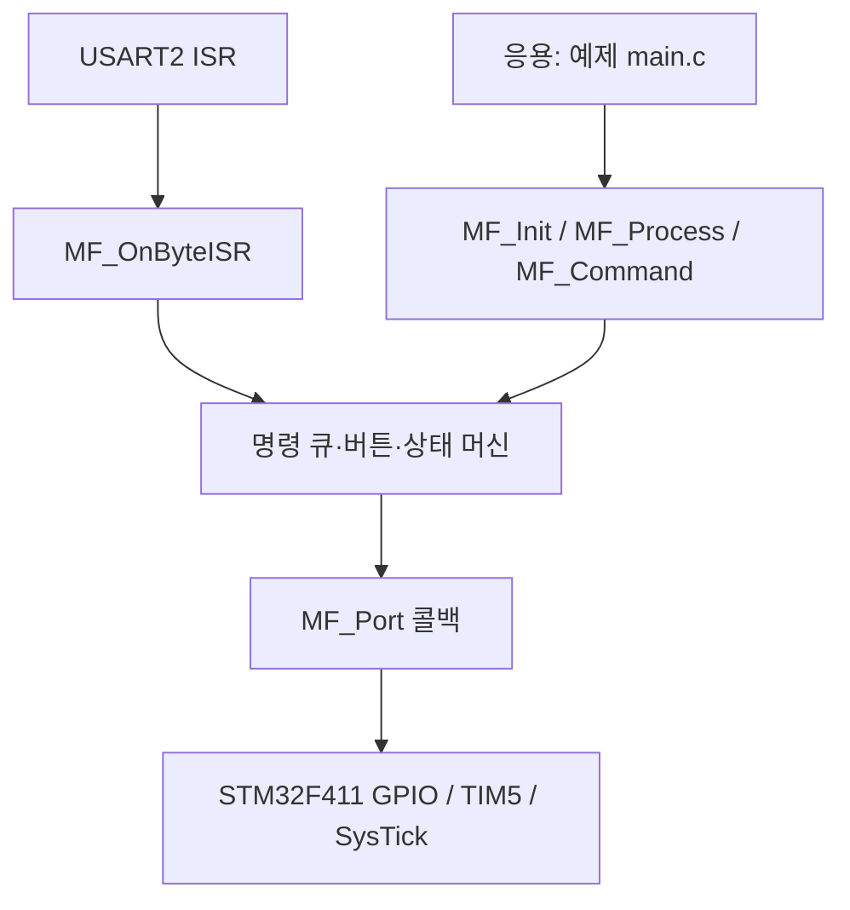

# 프레임워크로 바꾼 이유

## 1. 기존 optimized와의 차이

기존 버전에서도 상태 머신과 버튼·입력 모듈은 분리되어 있었습니다.
하지만 main.c가 모듈 내부 함수와 UART 공유 버퍼를 직접 조합하고,
보드 핀 및 초기화 순서를 알고 있어야 했습니다.

이번 버전에서는 그 조합 자체를 MF_Init/MF_Process API 안으로 옮겼습니다.
응용은 상태 머신 내부 구현을 알지 않고 사용하고,
보드는 시간·버튼·출력·인터럽트 보호 기능만 제공합니다.

## 2. 세 계층의 책임

| 계층 | 포함하는 것 | 포함하지 않는 것 |
| --- | --- | --- |
| framework | 모터 상태·시간 정책·입력 큐·버튼 처리·공개 API | STM32 헤더·핀 번호·레지스터 |
| ports/stm32f411 | 클록·UART·GPIO·PWM·IRQ·critical section | 응용의 운용 시나리오 |
| examples | 초기화·설정값·주기 API 호출 | 인터럽트 핸들러 및 상태 머신 구현 |

다른 보드에서는 새로운 port를 구현하고 같은 framework를 재컴파일할 수 있습니다.
제공된 STM32 포트는 optimized의 하드웨어 코드를 재사용합니다.

## 3. 설정과 상태를 인스턴스에 보관

MF_Instance에 입력 큐, 버튼 상태, 모터 상태, 콜백, 설정을 모았습니다.
제어 코어의 전역 모터 상태나 단일 UART 전역 큐를 없앴습니다.

이는 코어 여러 개를 서로 독립적으로 시험할 수 있게 합니다.
하지만 보드 포트가 자동으로 여러 물리 모터를 지원하게 되는 것은 아닙니다.
현재 포트는 TIM5 PA0/PA1 모터 한 개, USART2 수신 대상 한 개를 갖습니다.
여러 모터를 실제로 쓰려면 출력 채널, 수신 분배와 보드 콜백 컨텍스트를 별도로 구현해야 합니다.

## 4. 콜백의 목적

코어는 GPIOA가 무엇인지 모릅니다.
대신 apply_output(user, direction, percent)을 호출합니다.
now_ms와 button_pressed도 같은 방식입니다.

enter_critical/exit_critical는 MCU 인터럽트 보호를 보드에 맡깁니다.
코어는 요청 확인부터 상태 갱신·출력 반영까지 하나의 짧은 보호 구간으로 처리합니다.
하드웨어 출력과 정지 이벤트의 실행 순서를 일관되게 유지하기 위한 방식입니다.

콜백은 보호 구간 안에서 호출되므로 반드시 짧고 대기하지 않아야 합니다.
UART 송신 대기, printf, sleep, 네트워크 요청, RTOS 대기 API를 넣으면 안 됩니다.
시스템에 적용하기 전 실제 보호 구간의 시간을 계측해야 합니다.

## 5. API 경계를 만든 이유

MF_Command는 CW/CCW/STOP/LEVEL 같은 의미 있는 요청을 받습니다.
응용이 F/R 문자 규칙이나 큐의 head/tail을 직접 다룰 필요가 없습니다.
UART ISR을 위한 MF_OnByteISR은 기존 문자 규칙을 유지하는 편의 어댑터입니다.

MF_Stop도 다른 API와 같은 비동기 요청입니다.
호출 즉시 하드웨어를 바꾸는 함수를 따로 섞으면
메인 상태와 실제 출력이 다시 어긋날 수 있으므로 Process가 출력을 소유합니다.

MF_GetStatus는 보호 구간에서 값을 복사하므로
응용이 상태 필드들을 읽는 도중 인터럽트가 오류 카운터를 갱신해
서로 다른 시점의 값을 섞는 것을 피합니다.

## 6. 이름 공간과 배포

함수·타입에 MF 접두사를 적용해 다른 프로젝트의 Button_Init 같은 이름과 충돌할 가능성을 줄였습니다.
내부 controller/button/input 모듈을 포함한 코어 네 파일을
libmotor_framework.a로 묶어 실제로 링크합니다.

.a 파일만으로 다른 아키텍처에 이식할 수는 없습니다.
Cortex-M4 hard-float 외의 도구 설정에서는 소스와 헤더를 새로 컴파일해야 합니다.
사용한 CMSIS/STM32 헤더의 원래 저작권 주석은 유지했습니다.
별도 오픈소스 라이선스나 배포 권리를 새로 부여하지 않았습니다.

## 7. 성능과 범위

콜백과 구성 가능한 상태가 추가되어 text는 optimized 2368 → 3416 bytes,
bss는 76 → 152 bytes로 증가했습니다. 두 수치는 이번 환경의 기본 빌드 결과입니다.
이 수치에 스택·IRQ 최악 지연은 포함되어 있지 않으며 속도 개선을 뜻하지 않습니다.

목표는 보드 교체·기능 추가·테스트를 쉽게 만드는 재사용 구조입니다.
RTOS, DMA, 통신 프로토콜 확장, PID 속도 제어, 실제 RPM 계측,
동적 플러그인 로딩이나 자동 하드웨어 검색 기능을 추가한 것은 아닙니다.
